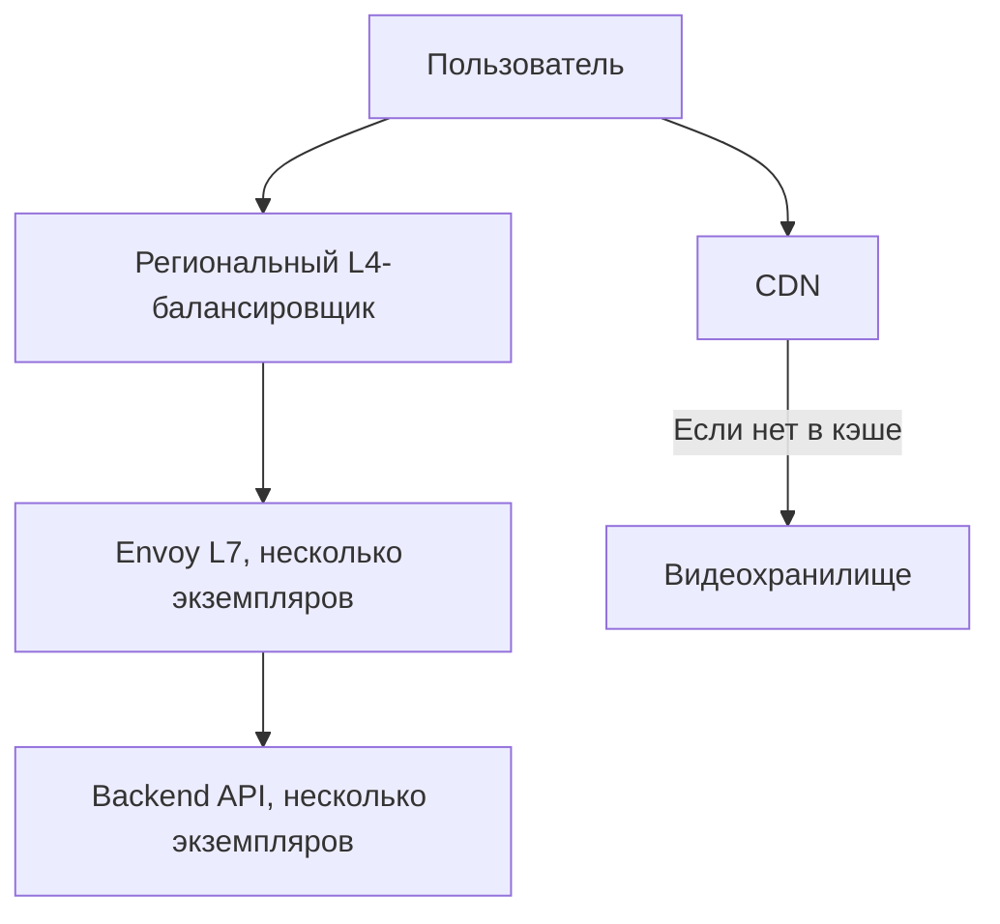
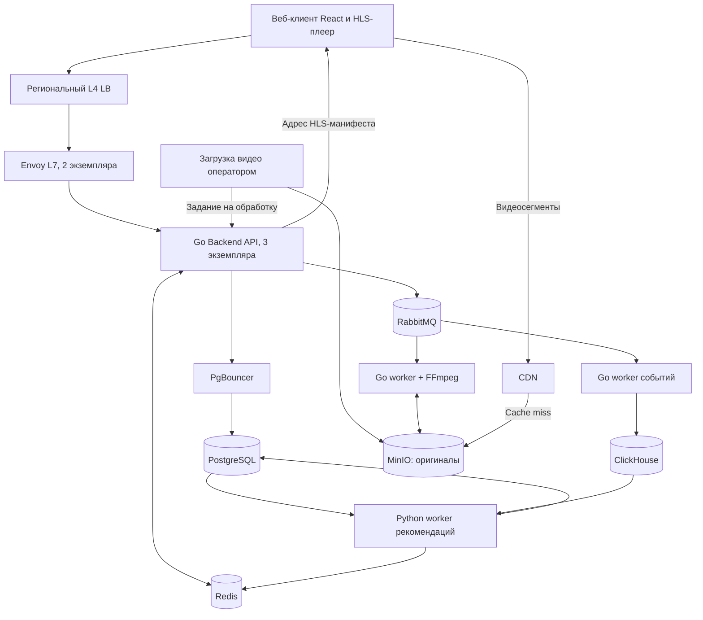
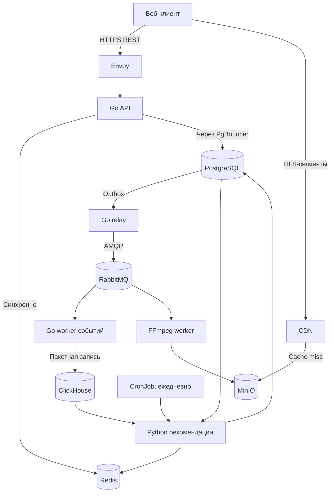

# Проект онлайн-кинотеатра

## 1. Описание сервиса

Проектируется онлайн-кинотеатр для пользователей из России с аудиторией 1 млн активных зрителей в месяц. Пользователь может найти фильм или сериал, посмотреть его, продолжить просмотр с сохранённого момента и получить рекомендации. Сервис рассчитан на просмотр по запросу, без прямых трансляций и загрузки собственных видео.

Основная нагрузка связана с доставкой видео. Запросы к каталогу и пользовательским данным обрабатываются через API, а видеосегменты передаются через CDN.

## 2. Актуальность и аудитория

Спрос на онлайн-кинотеатры подтверждается показателями существующих сервисов:

- **Кинопоиск** сообщил о более чем 18 млн смотрящих подписчиков в месяц по итогам 2025 года. В среднем подписчик смотрит контент 11 дней в месяц ([Кинопоиск, 2025](https://www.kinopoisk.ru/media/article/4012180/)).
- По исследованию **ICMR**, в III квартале 2026 года 53% опрошенных жителей российских городов 16–55 лет пользовались подписками на онлайн-кинотеатры, включая пробные и бесплатные. В исследовании участвовали 7200 человек. Среди крупнейших сервисов названы Кинопоиск, Okko, Иви, Wink и KION ([ICMR, 2026](https://www.icmr.ru/issledovaniya/rejting-onlajn-kinoteatrov-v-rossii-za-tretii-kvartal-2026-goda/)).

Для проекта принимается **1 млн MAU**. Это целевая расчётная нагрузка, а не прогноз числа пользователей нового продукта.

Распределение аудитории по федеральным округам оценено пропорционально численности населения на 1 января 2025 года ([Росстат](https://rosstat.gov.ru/folder/12781)). Фактические доли пользователей онлайн-кинотеатров могут отличаться.

| Федеральный округ | Доля аудитории | MAU |
|---|---:|---:|
| Центральный | 27,58% | 275 792 |
| Северо-Западный | 9,50% | 94 968 |
| Южный | 11,35% | 113 531 |
| Северо-Кавказский | 7,06% | 70 565 |
| Приволжский | 19,44% | 194 420 |
| Уральский | 8,41% | 84 059 |
| Сибирский | 11,29% | 112 872 |
| Дальневосточный | 5,38% | 53 793 |
| **Итого** | **100%** | **1 000 000** |

## 3. Функционал MVP

| Функция | Возможности пользователя |
|---|---|
| Каталог и поиск | Просмотр каталога, поиск по названию и жанру, карточки фильмов |
| Просмотр видео | Запуск фильма или серии, выбор качества |
| История просмотров | Сохранение позиции и продолжение на другом устройстве |
| Рекомендации | Подборки по истории просмотров и предпочтениям, выбранным при регистрации |

Для нового пользователя рекомендации формируются по выбранным жанрам; при отсутствии предпочтений показывается популярный контент. Для остальных пользователей подборки пересчитываются периодически и сохраняются для быстрой выдачи.

## 4. Продуктовые метрики

### 4.1. Аудитория и активность

| Показатель | Значение | Основание |
|---|---:|---|
| MAU | 1 000 000 | Условие проекта |
| Активных дней просмотра в месяц | 11 | Ориентир по данным Кинопоиска |
| Средний DAU | 366 667 | `1 000 000 × 11 / 30` |
| Время просмотра на DAU в день | 90 мин | Допущение |
| Среднее число одновременно смотрящих | 22 917 | `366 667 × 1,5 / 24` |
| Пиковое число одновременно смотрящих | 57 292 | Допущение: среднее × 2,5 |

В этой модели активным считается пользователь, который смотрел видео хотя бы раз за выбранный период. DAU и количество одновременных зрителей являются расчётными оценками, а не статистикой действующего сервиса.

### 4.2. Действия пользователя за день

| Действие | Запросов на DAU | Средний ответ, КБ |
|---|---:|---:|
| Просмотр каталога | 6 | 40 |
| Поиск | 2 | 10 |
| Открытие карточки фильма | 4 | 8 |
| Получение рекомендаций | 2 | 15 |
| Начало воспроизведения | 1 | 2 |
| Обновление прогресса просмотра | 30 | 0,2 |
| Отправка событий для рекомендаций | 5 | 0,2 |
| **Всего** | **50** | **331 КБ за день** |

Частоты действий приняты для расчёта. Прогресс отправляется примерно раз в три минуты в течение 90 минут просмотра. Запросы видеосегментов к CDN учитываются отдельно.

### 4.3. Данные на пользователя

| Тип данных | Количество объектов | Объём, ГБ |
|---|---:|---:|
| Профиль | 1 | 0,0000020 |
| Настройки и предпочтения | 1 | 0,0000010 |
| История просмотров | 100 записей | 0,0000500 |
| Сохранённые позиции | 20 записей | 0,0000050 |
| Подборка рекомендаций | 100 записей | 0,0000016 |
| События поведения за 90 дней | 165 записей | 0,0000330 |
| **Всего личных данных** | **387 объектов** | **0,0000926** |

Размеры записей оценочные, до индексов и репликации. Видеотека хранится общая для всех пользователей. При выбранном ниже размере медиатеки её условная доля составляет ещё **0,291 ГБ на одного MAU**; это не личные данные пользователя.

## 5. Технические метрики

### 5.1. RPS

Средний RPS рассчитывается как `DAU × запросов на пользователя / 86 400`. Для пикового значения принят коэффициент 6, поскольку обращения пользователей распределяются по суткам неравномерно.

| Тип запроса | Средний RPS | Пиковый RPS |
|---|---:|---:|
| Каталог | 25,5 | 153 |
| Поиск | 8,5 | 51 |
| Карточка фильма | 17,0 | 102 |
| Рекомендации | 8,5 | 51 |
| Начало воспроизведения | 4,2 | 25 |
| Обновление прогресса | 127,3 | 764 |
| События поведения | 21,2 | 127 |
| **Всего API** | **212,2** | **1 273** |

### 5.2. Сетевой трафик

Для видео принято следующее распределение: 40% просмотров в 720p (3 Мбит/с), 50% в 1080p (5 Мбит/с) и 10% в 4K (15 Мбит/с). Средний битрейт составляет **5,2 Мбит/с**.

Пиковая нагрузка на CDN: `57 292 × 5,2 ≈ 298 Гбит/с`.

| Направление | За сутки | Пиковая скорость |
|---|---:|---:|
| Входящий трафик API | 18,3 ГБ | 10 Мбит/с |
| Исходящий трафик API | 121,4 ГБ | 67 Мбит/с |
| CDN → зрители | 1 287 ТБ | 298 Гбит/с |
| Видеохранилище → CDN | 128,7 ТБ | 29,8 Гбит/с |

Для API приняты средний входящий запрос в 1 КБ и суммарно 331 КБ ответов на DAU за день (таблица 4.2). Для CDN предполагается, что 90% объёма данных отдаются из кэша. Размеры приведены без сетевых накладных расходов.

### 5.3. Объём хранилища

Предполагается медиатека из 10 000 фильмов и серий средней длительностью 90 минут. Для каждого видео хранятся исходный файл и три версии для просмотра: 720p, 1080p и 4K.

| Тип данных | Количество | Объём, ТБ |
|---|---:|---:|
| Исходные видео | 10 000 файлов по 12 ГБ | 120,000 |
| Подготовленные видео, три качества | ≈27 млн сегментов | 170,775 |
| Постеры и метаданные | 10 000 комплектов | 0,005 |
| Профили и предпочтения | 2 млн записей | 0,003 |
| История и позиции просмотра | 120 млн записей | 0,055 |
| Рекомендации | 100 млн записей | 0,0016 |
| События за 90 дней | 165 млн записей | 0,033 |
| **Всего** | | **≈290,873** |

Для подготовленных видео учтены аудио и служебные данные с запасом 10%. Объём приведён без репликации, резервных копий и кэшей CDN.

## 6. Балансировка нагрузки

Запросы разделяются на два потока. Каталог, поиск, рекомендации и историю обслуживает API. Видеосегменты пользователь получает напрямую через CDN, поэтому основной видеотрафик не проходит через серверы приложения.

| Участок | Инструмент и алгоритм | Обоснование |
|---|---|---|
| Входящие соединения API | Отказоустойчивый L4-балансировщик | Распределяет соединения между экземплярами Envoy и исключает неработающие прокси |
| HTTP-запросы к API | **Envoy L7, Least Request (P2C)** | Выбирает из двух случайных экземпляров менее загруженный по активным запросам; подходит для операций разной длительности |
| Доставка видео | CDN с географической маршрутизацией и кэшированием | Снижает задержки у зрителей и нагрузку на исходное видеохранилище |

Балансировка API выполняется на стороне сервера. Экземпляры backend считаются одинаковыми по мощности и не хранят пользовательские сессии локально. При отказе одного из них запрос может обработать другой, поэтому sticky sessions не требуются.

**Почему Envoy:** он поддерживает маршрутизацию HTTP-запросов, алгоритм Least Request, проверки состояния экземпляров и плавный вывод сервера из эксплуатации. Обычный Round Robin проще, но не учитывает текущую занятость серверов. Least Connections ориентируется на соединения, что менее показательно для HTTP с повторным использованием соединений. Альтернативой был бы Nginx, однако для выбранного алгоритма и встроенных проверок состояния удобнее Envoy ([документация](https://www.envoyproxy.io/docs/envoy/latest/intro/arch_overview/upstream/load_balancing/load_balancers.html)).

Перед направлением трафика экземпляр проходит проверку готовности (**readiness check**). При обновлении он сначала перестаёт получать новые запросы и завершает текущие (**draining**). Это позволяет выводить серверы из работы без резкого обрыва запросов.

Отдельная глобальная балансировка API пока не предусмотрена: сервис ориентирован на Россию, а географическую доставку видео обеспечивает CDN. Для API достаточно отказоустойчивого размещения в одном регионе с несколькими экземплярами прокси и приложения.

## 7. Системы хранения данных

### 7.1. Категории данных и выбор хранилищ

| Категория | Данные и характер обращений | Решение |
|---|---|---|
| Основные данные | Профили, предпочтения, карточки фильмов, история и позиции просмотра, готовые рекомендации. Чтение по ID, фильтрация, обновления | **PostgreSQL** |
| Видеотека | Исходные видео, сегменты в разных качествах, манифесты, постеры. Запись сравнительно редкая, чтение большими объёмами через CDN | **S3-совместимое объектное хранилище (MinIO)** |
| Кэш | Популярные карточки и подборки рекомендаций. Частое чтение по известному ключу | **Redis** |
| Очередь событий | События просмотра для последующей аналитики и пересчёта рекомендаций. Короткие сообщения, асинхронная обработка | **RabbitMQ** |
| События и логи | История пользовательских событий за 90 дней и выборочные технические логи за 7 дней. Массовая запись и аналитические запросы | **ClickHouse** |
| Метрики инфраструктуры | CPU, память, задержки, RPS, состояние БД, очередей и хранилищ | **Prometheus** |
| Координация реплик ClickHouse | Служебные метаданные и состояние репликации | **ClickHouse Keeper** |

**Почему выбраны эти решения.** PostgreSQL подходит для связанных сущностей и изменений, для которых важна целостность данных. Отдельная MongoDB здесь не даёт явного преимущества: гибкие атрибуты фильмов при необходимости можно хранить в `JSONB`. Поиск по каталогу из 10 тыс. названий предполагается выполнять средствами PostgreSQL с полнотекстовым индексом. При расчётном пике около 51 поискового запроса в секунду отдельный кластер Elasticsearch пока не требуется.

Видео нецелесообразно хранить в PostgreSQL: крупные объекты увеличили бы стоимость резервного копирования и усложнили обслуживание БД. S3-совместимое хранилище рассчитано на объекты, а CDN снимает с него большую часть пользовательских чтений. Redis используется только как кэш, а не как единственный источник рекомендаций. Memcached тоже подходит для простого кэша, но Redis удобнее для хранения списков и других структур с TTL.

ClickHouse выбран для аналитики просмотров и логов, поскольку эти данные преимущественно добавляются и затем обрабатываются большими выборками. Использовать для них основную PostgreSQL невыгодно: аналитические сканирования будут конкурировать с пользовательскими запросами. Cassandra не требуется при текущем потоке событий: расчётный пик составляет 127 событий в секунду. RabbitMQ отделяет приём событий от их обработки; Kafka на такой нагрузке и при отсутствии требований к длительному воспроизведению потока усложнила бы систему. Для метрик используется Prometheus, поэтому отдельная Time-Series СУБД не нужна.

Рекомендации в MVP формируются периодически на основе предпочтений и истории просмотров. Готовые списки сохраняются в PostgreSQL и кэшируются в Redis. Отдельное векторное хранилище для этого алгоритма не требуется.

### 7.2. Расчёт объёма хранения

За основу взяты значения из разделов 4.3 и 5.3. Для запаса принимается рост объёма данных на **30%**. Далее учитываются индексы, сжатие, репликация и срок хранения там, где они существенны. Для расчётов используется десятичный ТБ: 1 ТБ = 1000 ГБ.

| Хранилище | Объекты и исходный объём | Объём с учётом роста и избыточности |
|---|---|---:|
| PostgreSQL | 2 млн записей профилей и настроек, 120 млн записей истории и позиций, 100 млн элементов рекомендаций, 10 тыс. карточек. **0,060 ТБ** | **0,31 ТБ**: коэффициент 2 на индексы и служебные данные, рост 30%, primary и standby. Отдельно около **0,16 ТБ** под резервную копию |
| MinIO | 10 тыс. исходных файлов (120 ТБ), около 27 млн видеосегментов (170,775 ТБ), постеры (0,005 ТБ). **290,78 ТБ** | **567 ТБ** физически: рост 30% и erasure coding 8+4 (коэффициент 1,5). Дополнительно **156 ТБ логических данных** для отдельной резервной копии оригиналов |
| Redis | До 1 млн кэшированных подборок по 100 ID, карточки каталога и временные ключи. Около **2 ГБ полезных данных** | **10,4 ГБ RAM суммарно**: двукратный запас на структуры и накладные расходы, рост 30%, две копии |
| RabbitMQ | До **11 млн сообщений** при остановке потребителей на сутки в пиковом режиме. По 500 Б на сообщение, около 5,5 ГБ | **21,5 ГБ**: три копии и рост 30%; место для журналов и пикового восстановления выделяется дополнительно |
| ClickHouse | 165 млн событий за 90 дней (33 ГБ) и около 12,8 млн выбранных логов за 7 дней (3,85 ГБ) | **0,048 ТБ**: условное сжатие в 2 раза, рост 30%, две реплики. С учётом временного места для слияний планируется около **0,10 ТБ** |
| Prometheus | Около 5 тыс. временных рядов, опрос раз в 30 секунд, хранение 30 дней: **432 млн измерений** | **0,007 ТБ** на две копии с условной оценкой 3 Б на измерение, двукратными накладными расходами и ростом 30% |
| ClickHouse Keeper | Служебные метаданные репликации, менее **1 ГБ** на узел при принятом размере кластера | До **0,004 ТБ** суммарно для трёх экземпляров с запасом 30%; на каждом узле выделяется 20 ГБ для журналов и обслуживания |

Для логов принято сохранение примерно 10% успешных API-запросов и всех ошибок; объём 3,85 ГБ рассчитан по выборке 10% от общего числа запросов по 300 Б за 7 дней. Размер событий, сжатие и служебные расходы являются оценками и уточняются по фактическим данным.

Для MinIO **567 ТБ** обозначают занятую физическую ёмкость с учётом кодирования, а не размер дисков, которые нужно закупить. Отдельная резервная копия оригиналов нужна на случай потери основного кластера: восстановить исходный файл из подготовленных версий без потерь качества нельзя. Варианты видео при необходимости можно повторно подготовить из оригиналов.

### 7.3. Аппаратные ресурсы

Оценка дана для самостоятельного развёртывания. Это стартовая конфигурация для проектирования, а не результат нагрузочного тестирования. Размеры дисков включают свободное место для обслуживания и восстановления.

| Система | Размещение | CPU и RAM на узел | Диски и сеть |
|---|---|---|---|
| PostgreSQL | 1 primary и 1 standby | 8 vCPU, 32 ГБ | 500 ГБ SSD на узел, сеть 10 Гбит/с |
| MinIO | 12 узлов хранения | 8 vCPU, 32 ГБ | 8 × 10 ТБ HDD на узел, сеть 25 Гбит/с; суммарно 960 ТБ сырых дисков |
| Redis | 1 primary и 1 replica | 2 vCPU, 16 ГБ | 20 ГБ SSD на узел, сеть 1 Гбит/с |
| RabbitMQ | 3 узла | 2 vCPU, 8 ГБ | 50 ГБ SSD на узел, сеть 1 Гбит/с |
| ClickHouse | 2 реплики | 8 vCPU, 32 ГБ | 200 ГБ SSD на узел, сеть 10 Гбит/с |
| Prometheus | 2 экземпляра | 2 vCPU, 8 ГБ | 30 ГБ SSD на узел, сеть 1 Гбит/с |
| ClickHouse Keeper | 3 независимых процесса, допускается размещение на существующих узлах | По 1 vCPU, 2 ГБ | По 20 ГБ SSD, сеть 1 Гбит/с |

Для MinIO планируется кодирование 8 блоков данных + 4 блока восстановления на набор из 12 дисков. При 960 ТБ установленной ёмкости расчётные 567 ТБ занимают около 59%, оставляя резерв для отказов, перераспределения данных и дальнейшего роста. По разделу 5.2 пиковая передача из origin в CDN составляет 29,8 Гбит/с. Агрегированную исходящую пропускную способность хранилища предусматриваем не менее **40 Гбит/с** с запасом. Наличие 25-гигабитных сетевых интерфейсов само по себе не гарантирует эту скорость: её нужно проверять нагрузочным тестом хранилища и сети.

### 7.4. Надёжность, масштабирование и эксплуатация

| Система | Настройка и обеспечение надёжности | Масштабирование и наблюдаемость |
|---|---|---|
| PostgreSQL | Потоковая репликация на standby, ежедневные резервные копии и архивирование WAL для восстановления на момент времени. Пользовательские изменения читаются с primary, если нужна немедленная актуальность. Подключения API ограничиваются пулом PgBouncer | Индексы по `user_id`, `film_id` и времени просмотра, полнотекстовый индекс каталога. При необходимости партиционирование истории по `user_id` и выделение read replicas. Контроль p95/p99, блокировок, числа соединений, размера БД и задержки репликации |
| MinIO | Erasure coding 8+4, проверка целостности, отдельный бэкап оригиналов в другом размещении и периодические тесты восстановления. Доступ к сегментам через CDN | Увеличение ёмкости добавлением узлов или пулов хранения. Контроль свободного места, отказов дисков, ошибок чтения, задержек запросов, исходящего трафика и cache hit ratio CDN |
| Redis | Реплика и три Sentinel для обнаружения отказа и переключения primary. TTL для кэшируемых данных, политика `allkeys-lru`. Потеря кэша допустима: данные восстанавливаются из PostgreSQL | При росте объёма возможен Redis Cluster. Мониторинг памяти, вытеснений ключей, попаданий в кэш, задержек и состояния репликации |
| RabbitMQ | Quorum queue из трёх реплик, подтверждение публикации и обработки сообщений, повторные попытки и очередь ошибочных сообщений. Потребители обрабатывают повторы по уникальному ID события | Масштабирование числом потребителей; при необходимости распределение нагрузки по нескольким очередям. Мониторинг длины очереди, времени ожидания, скорости обработки, ошибок и состояния кворума |
| ClickHouse | `ReplicatedMergeTree`, две реплики и три процесса ClickHouse Keeper. Данные разделяются по месяцам; TTL 90 дней для событий и 7 дней для логов. Резервные копии в объектное хранилище | Массовые вставки пачками. При росте объёма добавляются шарды. Мониторинг задержки репликации, числа частей данных, фоновых слияний, объёма дисков и времени запросов |
| Prometheus | Два независимых экземпляра, хранение 30 дней, правила оповещения о недоступности и превышении порогов | Дополнительные экземпляры или удалённое долговременное хранилище при росте объёма метрик. Контроль числа рядов, времени сбора и пропущенных измерений |
| ClickHouse Keeper | Три участника кворума (для работы требуется большинство), резервные копии служебных метаданных | В рамках выбранной конфигурации масштабирование не требуется. Контроль наличия лидера, кворума и задержек операций |

Основные метрики собираются в Prometheus и отображаются в Grafana. Оповещения настраиваются как минимум для нехватки дискового пространства, недоступности реплик, роста p99 запросов к БД, задержки очереди и превышения ожидаемого трафика из origin. Резервные копии считаются рабочими только после периодической проверки восстановления.

### 7.5. Источники по выбранным решениям

- [PostgreSQL: высокая доступность и репликация](https://www.postgresql.org/docs/current/high-availability.html)
- [PostgreSQL: полнотекстовый поиск](https://www.postgresql.org/docs/current/textsearch.html)
- [MinIO: erasure coding](https://docs.min.io/aistor/operations/core-concepts/erasure-coding/)
- [RabbitMQ: quorum queues](https://www.rabbitmq.com/docs/quorum-queues)
- [ClickHouse: TTL и управление сроком хранения](https://clickhouse.com/docs/guides/developer/ttl)
- [Prometheus: локальное хранение метрик](https://prometheus.io/docs/prometheus/latest/storage/)

## 8. Программные инструменты и аппаратное обеспечение

### 8.1. Языки, runtime и фреймворки

| Компонент | Язык и runtime | Инструменты | Обоснование |
|---|---|---|---|
| Веб-клиент | TypeScript, JavaScript в браузере | React, Vite, hls.js | Интерфейс загружается как статические файлы через CDN. React используется для каталога, поиска и истории, hls.js — для воспроизведения HLS там, где нет встроенной поддержки. Отдельный сервер для рендеринга страниц в MVP не нужен |
| Backend API | Go, компилируемый бинарный файл с Go runtime | `net/http`, chi, pgx, go-redis | Один HTTP-сервис с модулями каталога, поиска, воспроизведения, истории и рекомендаций. Goroutines позволяют обслуживать множество сетевых запросов без отдельного потока ОС на каждый запрос. Go имеет сборщик мусора, поэтому число аллокаций и p99 проверяются при тестировании |
| Обработчик событий | Go, Go runtime | amqp091-go, clickhouse-go | Получает сообщения из RabbitMQ, группирует их в пачки и сохраняет в ClickHouse. Отдельный процесс не задерживает ответы API записью аналитических событий |
| Расчёт рекомендаций | Python 3, CPython | NumPy, scikit-learn | Периодический расчёт подборок по жанрам, предпочтениям и истории просмотров. Для MVP достаточно CPU; результат сохраняется в PostgreSQL и кэшируется в Redis. Python выбран из-за готовых библиотек для обработки признаков, а не для обслуживания HTTP-трафика |
| Подготовка видео | Go для управления заданием; FFmpeg как отдельный исполняемый процесс | FFmpeg, HLS | После загрузки оригинала формируются версии 720p, 1080p и 4K и сегменты для CDN. Вычислительно тяжёлое кодирование изолировано от API |
| Входной HTTP-шлюз | Готовый сервис Envoy (C++), без собственной бизнес-логики | Envoy Proxy | L7-маршрутизация, проверки готовности и Least Request (P2C) согласно разделу 6 |

Внешний API использует HTTP/JSON: для небольших ответов каталога и истории этого достаточно, а сериализация не является основной статьёй нагрузки. В Go следует переиспользовать HTTP- и DB-соединения и избегать лишнего копирования больших JSON-структур. Видео не сериализуется в JSON и не передаётся через API. Внутренний формат сообщений RabbitMQ также может быть JSON: при расчётном пике 127 событий/с переход на Protobuf не даёт очевидного выигрыша.

Для API рассматривались также Python/FastAPI и Node.js. Они подходят для I/O-запросов, однако Go позволяет получить компактный самостоятельный бинарный файл и контролировать конкурентность без запуска нескольких процессов интерпретатора. Для расчёта рекомендаций ситуация обратная: у Python более удобная экосистема численных библиотек. Создание отдельного ML inference-сервиса и использование GPU в MVP не требуются.

### 8.2. Архитектура компонентов

Go Backend API представляет собой одно приложение с несколькими модулями, а не набор отдельных микросервисов. При пиковых 1 273 RPS из раздела 5.1 нет необходимости заранее вводить дополнительные сетевые вызовы между модулями. Экземпляры API не хранят пользовательское состояние локально. Прогресс просмотра записывается в PostgreSQL, подготовленные рекомендации читаются из Redis с резервным чтением из PostgreSQL.

События просмотра публикуются в RabbitMQ и обрабатываются независимо от клиентского запроса. Потеря отдельного аналитического события не должна препятствовать просмотру; для значимых изменений прогресса источником данных остаётся PostgreSQL. Python-воркер выполняет периодический перерасчёт рекомендаций, а обработчик FFmpeg работает только при появлении нового видео. Основной видеотрафик идёт по маршруту «клиент → CDN → MinIO при промахе кэша» и не проходит через Go API.

### 8.3. Аппаратные ресурсы компонентов

Используются серверные процессоры x86-64 класса AMD EPYC или Intel Xeon, оперативная память DDR4/DDR5 ECC. Для временных файлов приложения достаточно SSD, а для промежуточных файлов кодирования выбран NVMe из-за последовательного чтения и записи больших объёмов. Ориентиры для дисков: SSD от 3 тыс. IOPS и 200 МБ/с, NVMe для кодирования от 10 тыс. IOPS и 1 ГБ/с. Целевая задержка сети между компонентами в одной зоне доступности — до 2 мс. Это проектные требования для проверки при выборе инфраструктуры, а не измеренные показатели.

| Компонент | Количество | CPU и RAM на экземпляр | Диск и сеть на экземпляр | Причина выбора |
|---|---:|---|---|---|
| Envoy | 2 | 2 vCPU, 4 ГБ | SSD 20 ГБ, 1 Гбит/с | Терминирует TLS и маршрутизирует небольшие API-ответы; второй экземпляр нужен на случай отказа |
| Go Backend API | 3 | 4 vCPU, 8 ГБ | SSD 30 ГБ, 1 Гбит/с | Основная работа связана с HTTP и ожиданием БД; локальные диски используются только для временных данных и журналов |
| Go worker событий | 2 | 2 vCPU, 4 ГБ | SSD 20 ГБ, 1 Гбит/с | Обработка сообщений и пакетные записи в ClickHouse; два потребителя дают запас на отказ |
| Python worker рекомендаций | 2 задания параллельно при пересчёте | 8 vCPU, 16 ГБ | NVMe 100 ГБ, 1 Гбит/с | Обработка предпочтений и истории просмотров, промежуточные матрицы признаков в RAM |
| Worker подготовки видео | 2 | 32 vCPU, 64 ГБ | NVMe 1 ТБ, 10 Гбит/с | Ресурсоёмкое кодирование нескольких профилей качества и временное хранение исходного файла |
| Веб-клиент, CDN и L4 LB | Управляемая внешняя инфраструктура | Серверные CPU и RAM не выделяются в рамках проекта | CDN: до 298 Гбит/с исходящего трафика, origin: до 29,8 Гбит/с | Нагрузка на видеодоставку передаётся CDN-провайдеру; требования к MinIO приведены в разделе 7.3 |

Ресурсы PostgreSQL, MinIO, Redis, RabbitMQ, ClickHouse, Prometheus и ClickHouse Keeper рассчитаны в разделе 7.3 и повторно здесь не учитываются. Для API целевая проверяемая производительность одного экземпляра составляет **не менее 900 RPS** на выбранных ресурсах. При отказе одного из трёх экземпляров оставшиеся два должны выдержать расчётный пик 1 273 RPS. Это требование к нагрузочному тесту, а не гарантированная производительность Go. Пиковый API-трафик 67 Мбит/с из раздела 5.2 не требует выделенных многогигабитных каналов на каждом API-узле.

Для рекомендаций используется простой контентный алгоритм без нейросетевого инференса, поэтому GPU/TPU не закладываются. Кодирование видео на CPU необходимо проверить на реальных файлах 4K; если скорость подготовки окажется недостаточной, можно добавить аппаратное кодирование, не меняя пользовательский API.

### 8.4. Контейнеризация и размещение

Приложение, воркеры и Envoy собираются в Docker-образы и размещаются в Kubernetes. Для stateless-компонентов используются `Deployment`, для периодических рекомендаций — `CronJob`, а для обработки конкретных видео — отдельные задания из очереди. Начальный пул Kubernetes состоит из четырёх общих узлов по **16 vCPU и 64 ГБ RAM** и двух выделенных узлов кодирования по **32 vCPU и 64 ГБ RAM**. Выделенные узлы нужны, чтобы FFmpeg не вытеснял API по CPU и памяти.

Для API задаются три реплики, `readinessProbe`, `livenessProbe`, ограничения CPU/RAM и обновление `RollingUpdate` с `maxUnavailable: 0` и `maxSurge: 1`. Экземпляр, выводимый из эксплуатации, прекращает принимать новые запросы и завершает текущие. Резерв ресурсов общих узлов позволяет перераспределить критичные поды при отказе одного узла; точную размещаемость проверяют с учётом системных процессов и фактических `requests`.

PostgreSQL, MinIO и остальные хранилища на первом этапе размещаются отдельно от кластера приложений согласно разделу 7.3. Такой вариант упрощает управление дисками и резервными копиями. Kubernetes выбран для воспроизводимого размещения нескольких реплик и контролируемых обновлений. Более простой альтернативой были бы Docker Compose или отдельные виртуальные машины, но при нескольких экземплярах API и воркеров отказоустойчивые обновления и перенос нагрузки между узлами пришлось бы организовывать вручную.

### 8.5. Тестирование

| Вид тестирования | Инструменты | Что проверяется |
|---|---|---|
| Модульное | Go `testing`, `httptest`; Python `pytest`; Vitest для веб-клиента | Расчёт рекомендаций, обработка запросов и событий, преобразования данных, логика сохранения прогресса |
| Интеграционное | Testcontainers, Docker Compose | Работа API с PostgreSQL, Redis и RabbitMQ, запись событий в ClickHouse, повторная обработка сообщений, получение видеоманифеста |
| Пользовательские сценарии | Playwright | Поиск фильма, запуск воспроизведения, сохранение позиции и продолжение просмотра |
| Нагрузочное | k6, метрики Prometheus/Grafana | Не менее 1 273 RPS по смеси запросов из таблицы 5.1, p95/p99, частота ошибок, очередь соединений и работа при остановке одного API-инстанса |
| Проверка видеодоставки | FFmpeg/ffprobe, тесты CDN-провайдера | Корректность сегментов и переключения качества, задержки загрузки, cache hit ratio; пропускная способность CDN 298 Гбит/с подтверждается отдельно от нагрузочного теста API |

Нагрузочный тест проводится после прогрева кэшей и с данными, близкими к расчётному объёму. Проверяются не только обычная работа, но и отказ одного экземпляра API, задержка PostgreSQL и временная недоступность RabbitMQ. Полученные показатели используются для пересмотра конфигурации и числа экземпляров.

### 8.6. Сборка и развёртывание

Для CI/CD используется GitHub Actions: проверки форматирования и тесты, сборка Docker-образов, публикация в registry и развёртывание через Helm. Образы маркируются хешем коммита, чтобы можно было вернуть предыдущую версию. Обновление API проходит постепенно с проверкой readiness и ошибок после выпуска. Миграции PostgreSQL выполняются отдельно и в совместимом с предыдущей версией приложения порядке.

Документация по основным инструментам: [Go/chi](https://github.com/go-chi/chi), [hls.js](https://github.com/video-dev/hls.js), [Envoy](https://www.envoyproxy.io/docs/envoy/latest/intro/arch_overview/upstream/load_balancing/load_balancers.html), [Kubernetes: обновления](https://kubernetes.io/docs/tasks/run-application/update-deployment-rolling/), [Kubernetes: проверки состояния](https://kubernetes.io/docs/tasks/configure-pod-container/configure-liveness-readiness-startup-probes/).

## 9. Взаимодействие компонентов

### 9.1. Схемы взаимодействия

Основной принцип: запросы, результат которых нужен пользователю сразу, выполняются синхронно. Сбор событий, аналитика, рекомендации и подготовка видео выполняются отдельно от пользовательского запроса. Расчётная нагрузка составляет 1 273 RPS на бизнес-API, из которых около 127 RPS приходится на отправку событий. Видеодоставка с пиком 298 Гбит/с остаётся за пределами API (раздел 5).

| Отправитель → получатель | Способ | Назначение и причина выбора |
|---|---|---|
| Веб-клиент → Envoy → Go API | Синхронно, HTTPS/REST, JSON | Каталог, поиск, карточка фильма, рекомендации, начало просмотра. Ответ требуется для отображения интерфейса |
| Go API → Redis | Синхронно, протокол Redis | Получение готовых подборок и кэшированных карточек. При промахе или недоступности Redis данные читаются из PostgreSQL |
| Go API → PostgreSQL через PgBouncer | Синхронно, PostgreSQL wire protocol | Чтение каталога и истории, сохранение позиции просмотра. Для прогресса требуется подтверждение записи до ответа клиенту |
| Веб-плеер → CDN → MinIO при cache miss | Синхронно, HTTPS/HLS и S3 API на участке CDN–origin | Плеер получает манифест и сегменты напрямую через CDN. Backend не передаёт видеофайлы |
| Go API → PostgreSQL (outbox) → RabbitMQ | Асинхронно после фиксации события | События просмотров поступают в обработку независимо от времени ответа пользователю. Outbox защищает от потери сообщения между БД и брокером |
| RabbitMQ → Go worker событий → ClickHouse | Асинхронно, AMQP 0-9-1 и пакетные вставки | Сбор событий для аналитики и будущих рекомендаций без тяжёлой записи в критическом пути API |
| Kubernetes CronJob → Python worker → PostgreSQL / ClickHouse | По расписанию, SQL-запросы | Периодический расчёт персональных подборок по предпочтениям и истории. Нет необходимости запускать модель на каждый запрос |
| Python worker → PostgreSQL, затем Redis | Синхронная запись по завершении расчёта | Сохранение очередной версии подборок в постоянном хранилище и обновление кэша |
| Административный интерфейс → Go API / MinIO | HTTPS/REST, S3 API | Регистрация видео и загрузка исходника. Загрузка крупного файла выполняется непосредственно в объектное хранилище |
| RabbitMQ → Go/FFmpeg worker → MinIO | Асинхронное задание, S3 API | Подготовка HLS-версий может занимать минуты или часы; пользовательский API не должен ждать её завершения |

Для важных событий (например, начало и завершение просмотра) API сохраняет бизнес-изменение и событие в `outbox` одной транзакцией PostgreSQL. Небольшой Go-процесс периодически публикует новые записи из `outbox` в RabbitMQ. При нескольких экземплярах relay используется выборка с `FOR UPDATE SKIP LOCKED`, чтобы не обрабатывать одну строку одновременно. Успешная публикация подтверждается RabbitMQ, после чего запись помечается отправленной. Дубликаты при повторной отправке допустимы и отсекаются при обработке.

Обновления позиции просмотра каждые три минуты остаются обычной записью в PostgreSQL и **не порождают отдельное сообщение в RabbitMQ на каждое обновление**. В расчёте 127 событий/с учитываются только выбранные поведенческие события, как и в разделе 5.1. Это не увеличивает поток сообщений до 764 записей прогресса/с.

### 9.2. Выбор протоколов и инфраструктуры

**REST/HTTP с JSON** используется во внешнем API. Он подходит для операций с каталогом, прогрессом и рекомендациями, поддерживает стандартные коды ошибок и простую интеграцию с браузером. Для спецификации API применяется OpenAPI. gRPC мог бы сократить издержки сериализации между отдельными сервисами, но в проекте основная бизнес-логика находится в одном Go-приложении. GraphQL позволил бы клиенту выбирать произвольные поля, однако усложнил бы контроль стоимости запросов и пока не нужен для четырёх функций MVP.

**RabbitMQ с quorum queues** используется как брокер задач и событий. Он поддерживает подтверждения, маршрутизацию по очередям и повторную доставку. При пике около 127 поведенческих событий/с нет подтверждённой необходимости в Kafka с длительным журналом, возможностью массового replay и отдельной инфраструктурой partition/consumer group. NATS проще для части сценариев обмена, но RabbitMQ лучше соответствует уже выбранной модели подтверждаемых фоновых заданий. Для независимой доставки аналитике и другим будущим обработчикам используются отдельные очереди, связанные с exchange, а не несколько конкурирующих подписчиков одной очереди.

**Envoy L7** остаётся reverse proxy и балансировщиком по схеме раздела 6: TLS termination, маршрутизация по URL, readiness и Least Request. Отдельный API Gateway пока не нужен, поскольку число внешних API невелико, а авторизация, проверка ограничений и формат ответов реализуются в Go API. Service Mesh не используется: между компонентами мало сетевых взаимодействий, и дополнительные прокси увеличили бы сложность эксплуатации. Для внутреннего трафика применяются закрытая сеть и TLS там, где он поддерживается.

### 9.3. Ошибки, гарантии и повторные попытки

| Сценарий | Решение |
|---|---|
| Сохранение истории и позиции | Ответ `2xx` выдаётся после успешного `COMMIT` в PostgreSQL. `PUT` позиции передаёт идентификатор просмотра и версию обновления, чтобы запоздавший запрос не перезаписал более новое состояние |
| Приём события | Событие имеет постоянный `eventId`; запись в `outbox` фиксируется в PostgreSQL, затем API возвращает подтверждение принятия. Публикация и обработка могут завершиться позже |
| Доставка через RabbitMQ | **At-least-once**: durable quorum queues из трёх узлов, persistent messages, publisher confirms, ручное подтверждение (`ack`) после успешной обработки |
| Повтор сообщения | Go worker учитывает `eventId`. При записи в ClickHouse возможен повтор пачки, поэтому аналитические расчёты, чувствительные к дубликатам, используют дедупликацию по `eventId`. Один лишь `ReplacingMergeTree` не даёт немедленной гарантии уникальности |
| Временная ошибка обработчика | До пяти попыток с увеличивающимися паузами (например, 5, 15, 45, 135 с и 5 мин), затем отправка в DLQ. Некорректный формат события сразу направляется в DLQ |
| Недоступность брокера | Непереданные записи остаются в PostgreSQL `outbox`; relay повторяет публикацию. Рост backlog отслеживается отдельно |
| Недоступность рекомендаций | Страница продолжает работать с последней сохранённой подборкой или списком популярных фильмов; запуск просмотра не зависит от ML-расчёта |
| Ошибка подготовки видео | Задание можно повторить с тем же `videoId` и версией кодирования; публикация готового HLS-манифеста выполняется после проверки всех сегментов |

Exactly-once на всю цепочку «PostgreSQL → RabbitMQ → ClickHouse» не предполагается: подтверждение брокера не делает внешнюю запись в ClickHouse атомарной. Требуемый результат достигается повторной доставкой и идемпотентностью обработчиков. Для outbox предусмотрена периодическая очистка уже отправленных записей и предупреждение при росте возраста самой старой непереданной записи.

Для синхронных вызовов устанавливается общий deadline и отдельные ограничения ожидания зависимостей. Начальные значения для нагрузочных испытаний: API каталога и рекомендаций до **500 мс**, поиск до **800 мс**, обновление прогресса до **800 мс**; ожидание Redis до **50 мс**, типичный запрос PostgreSQL до **250 мс**. Внутренние лимиты не должны превышать оставшееся время пользовательского запроса. Повторять разрешается только безопасные чтения или записи с устойчивым идентификатором/версией, не более одного повтора в пределах deadline. Для отказов зависимостей применяются ограничение конкурентности, exponential backoff и jitter. Это стартовые настройки, которые корректируются по p95/p99.

### 9.4. Наблюдаемость взаимодействий

Метрики сохраняются в Prometheus и выводятся в Grafana. Для API отслеживаются RPS, p95/p99, доля ответов `5xx`, таймауты, количество активных запросов и состояние downstream-соединений. Для RabbitMQ собираются скорость публикации и подтверждения, `ready/unacked`, возраст старейшего сообщения, число повторов и размер DLQ. Для Python и FFmpeg учитываются длительность задач, число ошибок, размер обрабатываемых партий и время от постановки задания до завершения.

В Go API и воркерах используется OpenTelemetry. Запросам назначается `traceId`, который передаётся через HTTP-заголовки и поля сообщений; отдельные этапы записи в БД, публикации и обработки событий отмечаются span. Для хранения выбранных трасс используется Grafana Tempo с выборкой 5% запросов и хранением 7 дней в отдельном бакете MinIO. При проектной нагрузке трассировка помогает находить медленные зависимости, но её объём ограничивается sampling и проверяется во время испытаний. Логи остаются в ClickHouse согласно разделу 7.

## 10. Обработка данных

### 10.1. Инструменты и задачи

| Задача | Инструмент | Режим и обоснование |
|---|---|---|
| Приём и запись поведенческих событий | Go worker, RabbitMQ, ClickHouse | Непрерывная обработка небольших сообщений с записью пачками по 500–1000 событий либо раз в секунду. Это дешевле одиночных вставок и укладывается в расчётные 127 событий/с |
| Расчёт персональных рекомендаций | Python, NumPy, scikit-learn, Kubernetes CronJob | Один запуск в сутки. Из ClickHouse берутся события, из PostgreSQL — данные фильмов и предпочтений. Рассчитываются до 100 идентификаторов фильмов на пользователя, результаты сохраняются по одной подборке на пользователя |
| Формирование HLS-видео | Go worker, FFmpeg, RabbitMQ | Запускается по административному заданию, создаёт три профиля качества. Отдельные вычислительные узлы не мешают API |
| Публикация событий из outbox | Go relay, PostgreSQL, RabbitMQ | Небольшие партии неподтверждённых записей с подтверждением доставки; отдельная полноценная система CDC не требуется |
| Расписание и запуск задач | Kubernetes CronJob и Job | CronJob запускает ежедневный пересчёт рекомендаций, `concurrencyPolicy: Forbid` предотвращает наложение запусков. Для кодирования используются задания из очереди |
| Метрики и трассировка | Prometheus, OpenTelemetry Collector, Grafana Tempo | Метрики, распределённые трассы и анализ задержек без отдельной самописной системы |

Для MVP не вводятся Apache Flink, Kafka Streams, Airflow и отдельный Feature Store. У проекта нет требований к сложным потоковым вычислениям с event-time окнами; аналитические события накапливаются в ClickHouse, а рекомендации обновляются периодически. Отдельный сервис онлайн-инференса (Triton, TensorRT, ONNX Runtime) и GPU также не требуются, поскольку подборки готовятся заранее. При росте количества независимых пайплайнов можно рассмотреть Airflow, а при потребности в персонализации в реальном времени — потоковую обработку и feature serving.

### 10.2. Ресурсы обработки

| Компонент | Экземпляры | Ресурсы на экземпляр | Нагрузка и ограничение |
|---|---:|---|---|
| Go worker событий | 2 | 2 vCPU, 4 ГБ RAM, SSD 20 ГБ, 1 Гбит/с | Обработка около 127 событий/с на пике; `prefetch` первоначально 50 на воркер, вставки в ClickHouse пачками |
| Go outbox relay | 2 | 1 vCPU, 2 ГБ RAM, SSD 10 ГБ, 1 Гбит/с | Опрос outbox с интервалом 1 с, несколько сотен сообщений за цикл. Ресурсы уточняются по задержке публикации |
| Python worker рекомендаций | 2 параллельных задания одного запуска | 8 vCPU, 16 ГБ RAM, NVMe 100 ГБ, 1 Гбит/с | Пересчёт раз в сутки для до 1 млн пользователей. Обработка порциями, а не загрузка всей истории в RAM |
| FFmpeg worker | 2 | 32 vCPU, 64 ГБ RAM, NVMe 1 ТБ, 10 Гбит/с | Подготовка 720p, 1080p и 4K. Число узлов корректируется по фактической скорости кодирования и частоте пополнения каталога |
| OpenTelemetry Collector | 1 | 2 vCPU, 2 ГБ RAM, SSD 10 ГБ, 1 Гбит/с | Приём и выборка трасс; в production при необходимости запускается второй экземпляр |
| Grafana Tempo | 1 | 2 vCPU, 4 ГБ RAM, SSD 20 ГБ, 1 Гбит/с | Хранение выборки трасс 7 дней в MinIO; объём и память уточняются после тестов |

Ресурсы PostgreSQL, MinIO, Redis, RabbitMQ, ClickHouse и Prometheus уже приведены в разделе 7.3; повторно они не суммируются. Значения CPU и RAM для существующих воркеров совпадают с разделом 8.3, а relay и компоненты трассировки добавлены отдельно. Общие 4 Kubernetes-узла должны быть проверены на размещаемость этих дополнительных подов с резервом под отказ узла.

### 10.3. Контроль качества обработки

Для событий проверяются уникальность `eventId`, корректность обязательных полей (`eventType`, `occurredAt`, `userId`, `videoId`) и совместимость версии схемы. Важные изменения контракта вводятся добавлением необязательных полей без удаления старых. Для рекомендаций контролируются доля пользователей с непустой подборкой, длительность перерасчёта, дата последнего обновления и ошибки записи. Публикация новой версии рекомендаций происходит только после успешного завершения расчёта соответствующей пользовательской порции.

Отдельно тестируются отключение RabbitMQ, повторная доставка событий, падение воркера после записи в ClickHouse, очередь заданий на кодирование и одновременный запуск перерасчёта рекомендаций. После восстановления проверяются длительность разгрузки backlog и отсутствие повторных бизнес-эффектов.

Основная документация: [RabbitMQ: подтверждения](https://www.rabbitmq.com/docs/confirms), [RabbitMQ: quorum queues](https://www.rabbitmq.com/docs/quorum-queues), [PostgreSQL: SKIP LOCKED](https://www.postgresql.org/docs/current/sql-select.html), [Kubernetes: CronJob](https://kubernetes.io/docs/concepts/workloads/controllers/cron-jobs/), [OpenTelemetry: распространение контекста](https://opentelemetry.io/docs/concepts/context-propagation/), [ClickHouse: дедупликация](https://clickhouse.com/docs/guides/developer/deduplication).

## 11. Обеспечение надёжности

### 11.1. Требования к надёжности

Приоритетными сценариями являются поиск фильма, запуск воспроизведения и сохранение позиции просмотра. Рекомендации, аналитика и подготовка новых видео могут временно отставать без остановки уже доступного контента. Все значения ниже представляют собой **проектные SLO**, а не результаты испытаний. Доступность рассчитывается за 30 дней, задержки p50/p95/p99 оцениваются при нагрузке из раздела 5. RTO означает целевое время восстановления после отказа, RPO — допустимую потерю уже сохранённых данных. Для компонентов без собственных данных RPO не применяется.

| Компонент или операция | Целевая доступность | Задержка p50 / p95 / p99 | RTO | RPO |
|---|---:|---|---|---|
| Каталог и карточки, Go API | 99,9% | 100 / 250 / 500 мс | 10 мин | Определяется PostgreSQL |
| Поиск, Go API | 99,9% | 150 / 400 / 800 мс | 10 мин | Определяется PostgreSQL |
| Сохранение позиции просмотра, Go API | 99,9% | 100 / 350 / 800 мс | 15 мин | Не более 5 мин |
| Выдача рекомендаций, Go API | 99% | 80 / 250 / 500 мс | 30 мин | Не более 24 ч для подборок |
| L4-балансировщик и Envoy | 99,95% | 5 / 20 / 50 мс добавленной задержки | 5 мин | Не применяется |
| CDN, доставка сегмента | 99,9% | 100 / 400 / 1500 мс | 1 ч* | Не применяется |
| PostgreSQL и PgBouncer | 99,9% | 10 / 100 / 250 мс на типовую SQL-операцию | 15 мин при отказе primary | Не более 5 мин |
| Redis | 99% | 2 / 10 / 50 мс | 30 мин | Кэш пересоздаётся |
| MinIO, выдача объекта в origin | 99,9% | 40 / 200 / 500 мс | 1 ч при отказе узла | До 24 ч для оригиналов |
| RabbitMQ, подтверждение публикации | 99,9% | 10 / 80 / 300 мс | 15 мин при отказе узла | Без потери подтверждённых сообщений при сохранении кворума |
| ClickHouse, аналитическое чтение | 99,5% | 100 / 800 / 2000 мс | 2 ч | До 24 ч, с восстановлением из доступных событий |
| ClickHouse Keeper | 99,9% | 5 / 30 / 100 мс на служебную операцию | 15 мин | Состояние восстанавливается из сохранённых метаданных |
| Go worker событий и outbox relay | 99% успешной обработки | 5 / 30 / 120 с от записи события до ClickHouse | 30 мин | Определяется outbox и RabbitMQ |
| Python worker рекомендаций | 99% ежедневных расчётов завершаются | 1 / 2 / 4 ч на полный пересчёт | 4 ч | До 24 ч: используется предыдущая версия |
| FFmpeg worker | 99% заданий завершаются успешно | 2 / 5 / 8 ч на обработку видео | 4 ч | Задание запускается повторно из оригинала |
| Prometheus, Tempo и сбор телеметрии | 99% | 0,2 / 1 / 3 с на запрос к данным мониторинга | 2 ч | До 24 ч для метрик; потеря части трасс допустима |
| Kubernetes CronJob для рекомендаций | 99% запусков по расписанию | 1 / 5 / 10 мин отклонения от расписания | 2 ч | Используется предыдущая подборка |

*Для CDN RTO зависит от условий провайдера. Возможность переключения на резервного поставщика в MVP не предусматривается, а прямой вывод всех видеопотоков на MinIO невозможен при рассчитанных 298 Гбит/с. Время запуска воспроизведения оценивается отдельно, целевой p95 от нажатия «Смотреть» до первого кадра — **не более 2 с** при доступности сценария **99,9%**. Эти показатели требуют проверки на разных сетях и устройствах.

Для асинхронных задач вместо задержки одного HTTP-запроса указано время доставки события или выполнения задания. В частности, ежедневная публикация рекомендаций должна завершаться до следующего расчётного периода. При ухудшении этих показателей уже сохранённые подборки продолжают обслуживаться.

### 11.2. Мониторинг и обнаружение деградации

Для сбора метрик используются Prometheus и экспортёры компонентов, для панелей — Grafana, для уведомлений — Alertmanager. Ошибки Go API и веб-клиента группируются в Sentry. OpenTelemetry Collector собирает трассировки API, outbox relay и обработчиков, Grafana Tempo хранит их выборку, как предусмотрено разделом 9.4.

| Точка сбора | Метрики и назначение |
|---|---|
| Envoy и Go API: HTTP-метрики непосредственно в сервисах | RPS по маршрутам, p50/p95/p99, доля `5xx`, число активных запросов, таймауты. Позволяют обнаружить ухудшение пользовательских операций |
| PostgreSQL, PgBouncer: `postgres_exporter`, `pg_stat_statements`, метрики пулера | Время SQL, ожидающие соединения, блокировки, свободные слоты, WAL, replication lag. Позволяют отличить перегрузку БД от нехватки соединений |
| Redis, RabbitMQ, ClickHouse, MinIO: штатные метрики и экспортёры | Hit ratio и память кэша; `ready/unacked`, возраст очереди и DLQ; задержка вставок и репликации; ошибки GET, свободное место и загрузка дисков |
| Kubernetes: `node_exporter`, `kube-state-metrics` | CPU, RAM, сеть, перезапуски контейнеров, состояние узлов и доступный резерв мощности |
| CDN и браузер | HTTP-ошибки и cache hit ratio от CDN-провайдера; ошибки плеера и время до первого кадра из клиентской телеметрии. Без клиентских метрик сбой воспроизведения может остаться незаметным для backend |
| Python/FFmpeg и outbox relay: метрики заданий | Возраст последнего расчёта рекомендаций, доля неуспешных заданий, продолжительность кодирования, возраст самой старой записи в outbox |

Первичные условия для оповещений: `5xx > 1%` в течение 5 минут, выход p99 за целевые значения, возраст сообщения в очереди более 2 минут, отсутствие успешного расчёта рекомендаций более 36 часов, уменьшение свободного пространства до 20%, превышение ожидаемой задержки репликации PostgreSQL. Для критических ошибок нужны оповещения дежурному; предупреждения о росте нагрузки фиксируются до наступления полного отказа. Пороговые значения уточняются после нагрузочных тестов. Два экземпляра Prometheus располагаются независимо; Alertmanager развёртывается в двух экземплярах, чтобы отказ одного не отключал уведомления.

### 11.3. Согласованность, репликация и восстановление данных

**PostgreSQL** остаётся источником истины для профилей, каталога, истории, позиций и готовых рекомендаций. После подтверждения сохранения позиции клиент должен видеть новое значение: соответствующие чтения выполняются с primary. Для PostgreSQL используется primary и асинхронная standby из раздела 7. Для автоматического переключения планируются Patroni и распределённое хранилище конфигурации из трёх участников etcd на независимых узлах. Старый primary должен быть исключён из маршрутизации записей до допуска нового, чтобы предотвратить split-brain. Наличие только одной асинхронной standby не гарантирует нулевой RPO, поэтому предусмотрены ежедневные физические копии и непрерывное архивирование WAL в независимое хранилище с проверяемым RPO до 5 минут. Восстановление после полной потери кластера рассчитывается отдельно: целевой RTO до 4 часов.

**MinIO** хранит оригиналы и подготовленные видео с erasure coding 8+4. Оригиналы резервируются один раз в сутки в другом домене отказа; отсюда RPO до 24 часов при разрушении основного хранилища. Подготовленные сегменты можно восстановить из оригиналов повторным кодированием. CDN не считается резервной копией, поскольку кэш может быть вытеснен.

**RabbitMQ** использует quorum queues из трёх узлов. Подтверждение публикации означает приём сообщения в рамках гарантий кворума, а потребитель подтверждает его только после успешной записи. Для событий, связанных с изменением истории, PostgreSQL и запись в outbox обновляются одной транзакцией. Отправленные события сохраняются в outbox в течение 7 дней для возможного повторного воспроизведения; повторы обрабатываются по `eventId`. При потере всего кластера брокера восстановление возможно лишь в пределах сохранившихся событий и резервных копий, поэтому нулевой RPO для такого сценария не заявляется.

**Redis** не хранит уникальных данных: при потере кэша карточки и рекомендации восстанавливаются из PostgreSQL. **ClickHouse** работает с двумя репликами и ClickHouse Keeper; резервные копии аналитических данных создаются ежедневно в объектное хранилище. Данные в ClickHouse считаются в конечном счёте согласованными с источником событий, а для пользователей допустимо запаздывание статистики и рекомендаций. Работоспособность резервных копий PostgreSQL, ClickHouse и MinIO проверяется восстановлением не реже одного раза в месяц.

### 11.4. Деградация при отказах

| Отказ | Поведение системы и ограничение ущерба |
|---|---|
| Один экземпляр API или Envoy | Readiness исключает экземпляр из балансировки, запросы переходят на оставшиеся узлы. Запас ресурсов проверяется при нагрузке 1 273 RPS |
| PostgreSQL primary | Patroni переключает записи на пригодную standby; во время переключения операции сохранения истории могут временно отвечать ошибкой. Запись не подтверждается до COMMIT |
| Redis | Допускается чтение из PostgreSQL с ограничением конкурентности и single-flight для популярных ключей. При перегрузке необязательные рекомендации заменяются популярными фильмами |
| RabbitMQ или обработчик событий | Данные сохраняются в outbox, а затем отправляются повторно. Просмотр и запись прогресса не ждут завершения аналитики; при исчерпании допустимого размера outbox включается ограничение приёма событий |
| ClickHouse или Python worker | Аналитика и пересчёт задерживаются; пользователю выдаётся предыдущая подборка или популярные фильмы. Запуск видео не зависит от их доступности |
| MinIO или CDN | Сегменты, присутствующие в кэше CDN, могут продолжать выдаваться. При недоступности отсутствующего сегмента воспроизведение может прерваться; полноценный обход CDN не гарантируется |
| FFmpeg worker | Новые видео публикуются позднее, уже подготовленные фильмы продолжают воспроизводиться |

Для защиты от каскадных отказов вводятся timeout, ограничение одновременных запросов к PostgreSQL и Redis (bulkheads), circuit breaker на проблемные зависимости, а также ограниченные повторы с backoff и jitter. При превышении ёмкости допускается быстрое отклонение части несущественных запросов. Критические операции просмотра и сохранения истории получают приоритет перед аналитикой и обновлением рекомендаций.

### 11.5. Работа с инцидентами

При нарушении SLO дежурный получает оповещение из Alertmanager. Инциденты разделяются по влиянию: **P1** — массовая недоступность воспроизведения или записи прогресса, **P2** — существенная деградация поиска или каталога, **P3** — задержка рекомендаций и аналитики. Для каждого инцидента назначается ответственный, фиксируются время начала, затронутые операции, действия и время восстановления.

Первая задача при инциденте — сократить влияние на пользователей: отключить необязательную функцию, ограничить нагрузку, остановить релиз или переключиться на резерв. После стабилизации проверяются отложенные сообщения, правильность записей и отсутствие повторных эффектов. Неудачные развёртывания откатываются или отключаются feature flag; обновления выполняются поэтапно, как указано в разделе 8. Для типовых ситуаций поддерживаются короткие инструкции восстановления (runbooks).

После серьёзного сбоя составляется post-mortem с хронологией, причинами, последствиями и мерами профилактики. Разбор проводится без поиска виновных: оцениваются архитектурные и организационные причины. Не реже одного раза в семестр проверяются сценарии отказа API-узла, primary PostgreSQL, RabbitMQ и восстановления данных из резервных копий.

Дополнительная документация: [Patroni: механизмы репликации и failover](https://patroni.readthedocs.io/en/latest/), [RabbitMQ: гарантии quorum queues](https://www.rabbitmq.com/docs/quorum-queues), [Prometheus: Alertmanager](https://prometheus.io/docs/alerting/latest/alertmanager/).
